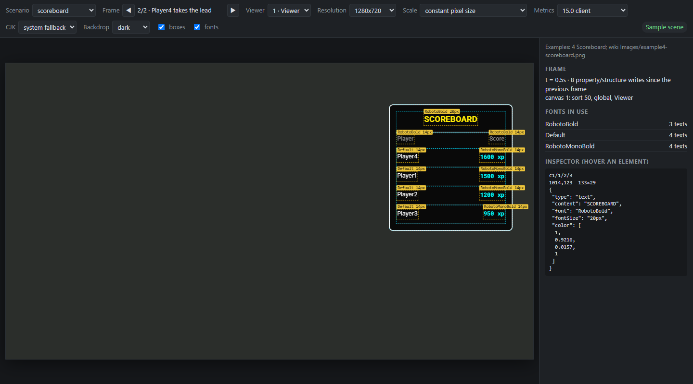
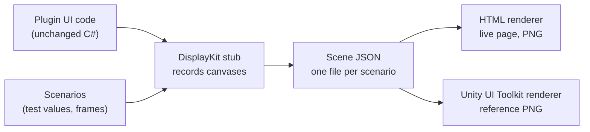
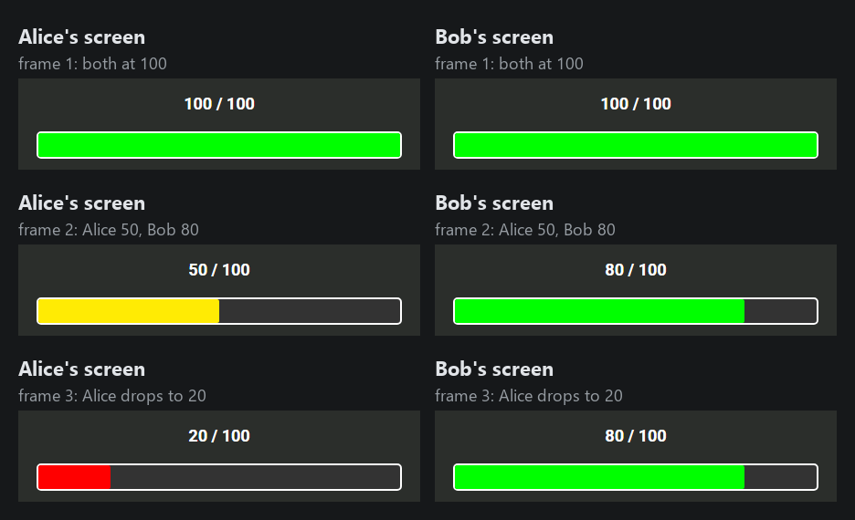
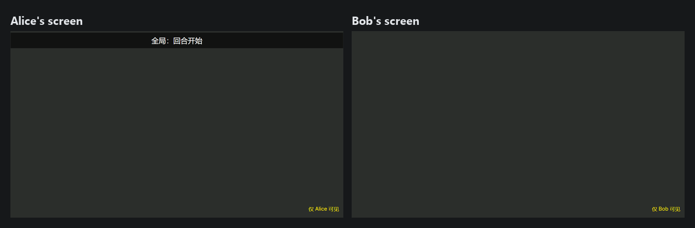
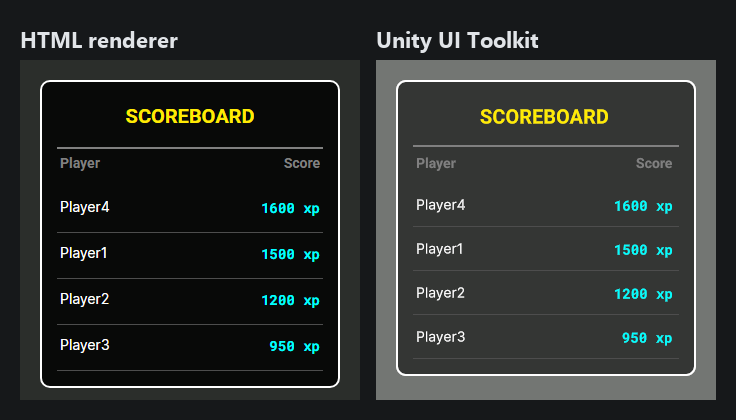

# DisplayKit preview

**English** | [简体中文](README.zh-CN.md)

See your SCP:SL 15.0 DisplayKit UI before the 15.0 server exists. Write the plugin's UI code in C#
as usual, add a few test scenarios, and see the result in a browser that redraws every time you save.



## How it works



- **The stub** (`src/DisplayKit.Stub`) has the same namespaces and types as DisplayKit. Instead of
  sending canvases over the network, it records them.
- **The runner** (`dkpreview.py run`) builds your scenario project, runs each scenario and writes one
  JSON file per scenario. Each file holds frames, viewers and the canvas tree.
- **Two renderers** draw that JSON:

| Renderer | Use it for |
| --- | --- |
| HTML (`html/`) | Day-to-day work. The live page reloads on every C# change. Headless PNGs for scripts and agents. |
| Unity UI Toolkit (`unity/`) | Checking fidelity. The same JSON in real `UIDocument`s, saved as a PNG with element rects. |

DisplayKit itself is not released yet; its API comes from the LabAPI wiki (`DisplayKit*.md`
pages). Where the wiki is silent or inconsistent, the stub makes a guess. Every guess is listed in
[the reference](docs/reference.md#guesses). Recheck them when 15.0 ships.

## Quick start: open the samples

You only need Python 3.10 or later. From the repository root:

```powershell
python -m pip install fonttools
python fonts.py                          # downloads the fonts both renderers use
python -m http.server 8765 --bind 127.0.0.1
```

Open <http://127.0.0.1:8765/html/>. Three recorded samples from `examples/` are bundled:

| Sample | Shows |
| --- | --- |
| `scoreboard` | The wiki's scoreboard example: one global canvas, updated over two frames |
| `health-bar` | Per-player canvases: each player sees only their own bar |
| `per-player-scope` | A global banner next to per-player labels, then the banner hidden for one player |

Stop the server with Ctrl+C.

## The preview page

| Control | What it does |
| --- | --- |
| **Scenario** | Pick a recorded scenario. |
| **Frame** | Step through the frames the scenario recorded (◀ ▶ or the arrow keys). |
| **Viewer** | Show the screen as one player sees it. Per-player canvases and visibility follow the viewer. |
| **Resolution**, **Scale** | Screen size, and constant pixel size or Unity's *Scale With Screen Size* (1920x1080, match 0.5). |
| **Metrics** | `15.0 client` (default) applies the real client's text placement; `UI Toolkit reference` matches the Unity renderer. |
| **CJK** | `system fallback` shows Chinese text with a fallback font (best case); `no fallback (□)` shows missing glyphs (worst case). |
| **Backdrop** | The colour behind the canvases. |
| **boxes**, **fonts** | Outline every element; label every text with its font and size. |

The side panel lists the fonts in use and flags text with characters the font lacks. It also shows
how many property writes the frame sent, which canvases are visible to the viewer, and the element
under the pointer.

Viewers matter whenever a canvas is per-player. In the `health-bar` sample, each player gets their own
canvas:



## Live preview of your own C#

### Requirements

| Needed for | Install |
| --- | --- |
| Building scenarios | .NET SDK 9 or later (the runner targets .NET 9 with roll-forward; the stub and scenarios target .NET Framework 4.8) |
| `ReferenceHub`, Mirror | SCP:SL Dedicated Server (Steam) |
| UnityEngine UI Toolkit modules | Unity 6000.4.10f1 (the Unity renderer also needs it) |
| PNG output | Chrome or Edge |
| `compare` | Pillow (`python -m pip install pillow`) |

`DisplayKitPreview.props` assumes the default Unity Hub and Steam install paths. If yours differ,
set the paths for the current shell:

```powershell
$env:DisplayKitUnityManaged = 'D:/Unity/6000.4.10f1/Editor/Data/Managed/UnityEngine'
$env:ScpslManaged = 'D:/SCP Secret Laboratory Dedicated Server/SCPSL_Data/Managed'
```

### Watch mode

```powershell
python dkpreview.py watch scenarios/WikiExamples
```

Open the URL it prints. Each time you save a `.cs` file in the scenario project, the project rebuilds and
reruns (about 1.5 s), and the page redraws. Compile errors and scenario exceptions appear over the
stage until you fix them. If the plugin's source lives outside the scenario project, add
`--watch <dir>` for each folder.

## Writing scenarios for your plugin

Put the DisplayKit code in a plugin class that takes the values it shows as arguments. The plugin calls
it from game events, and a scenario calls the same class with test values.
`scenarios/WikiExamples/ExamplesPage.cs` restructures the wiki examples this way.

**1. Add a scenario project next to the plugin.** Set `DISPLAYKIT_PREVIEW_ROOT` to this repository's
path:

```xml
<Project Sdk="Microsoft.NET.Sdk">
  <Import Project="$(DISPLAYKIT_PREVIEW_ROOT)\DisplayKitPreview.props" />
  <PropertyGroup><TargetFramework>net48</TargetFramework><LangVersion>latest</LangVersion></PropertyGroup>
  <ItemGroup>
    <ProjectReference Include="$(DisplayKitPreviewDir)src\DisplayKit.Stub\DisplayKit.Stub.csproj" />
    <ProjectReference Include="$(DisplayKitPreviewDir)src\DisplayKit.Preview\DisplayKit.Preview.csproj" />
    <Compile Include="..\src\Ui\**\*.cs" />  <!-- the plugin's UI classes, compiled unchanged -->
  </ItemGroup>
</Project>
```

**2. Write scenarios.** Each one is a static method that adds players, drives the plugin's UI and
records frames:

```csharp
[DisplayKitScenario("hud", Description = "SCP-049 cure HUD")]
public static void Hud(PreviewContext ctx)
{
    PreviewPlayer alice = ctx.AddPlayer("Alice");     // alice.Hub is a ReferenceHub DisplayKit accepts
    CureHud hud = CureHud.Create(alice.Hub);          // plugin code
    ctx.Frame("spawned");
    hud.SetProgress(0.4f);
    ctx.Frame(0.5f, "40%");                           // advance simulated time, record a frame
}
```

**3. Run `python dkpreview.py watch <scenario project>`** and open the page.

`PreviewContext` has these members:

| Member | Effect |
| --- | --- |
| `AddPlayer(name)` | Adds a player. Canvases that were spawned globally reach them as a late joiner. |
| `RemovePlayer(player)` | Removes a player. |
| `Frame(label)` | Records a frame now. |
| `Frame(seconds, label)` | Advances simulated time, then records a frame. |
| `Time` | The current simulated time. |

A scenario without frames records one at the end. Changes after the last frame record an `end`
frame. A scenario without players gets one called `Viewer`.

Switch the **Viewer** to check who sees what. Here, from the `per-player-scope` sample, the global banner
has been hidden for Bob only:



> [!IMPORTANT]
> A preview player's `ReferenceHub` only identifies the player. DisplayKit calls accept it, but reading
> game state from it throws, and so does comparing it with `==` (UnityEngine.Object's operator calls
> native code). This is why UI classes should take the values they display as arguments.

### Compiling the plugin against the stub

Before 15.0 is out, a plugin can compile its UI by referencing `DisplayKit.Stub.csproj` and importing
`DisplayKitPreview.props` for the Unity 6 references. When 15.0 ships, remove the stub reference;
the game assembly provides the same namespaces.

### Larger examples

| Project | What it is |
| --- | --- |
| `scenarios/WikiExamples` | The LabAPI wiki's examples and guide snippets, plus a font coverage page. The bundled samples come from here. |
| `scenarios/RoleIntro` | A complete role intro component with one scenario per faction, and a script that renders review sheets. See its [README](scenarios/RoleIntro/README.md). |

## Command reference

```powershell
python dkpreview.py run   scenarios/WikiExamples                    # build + all scenarios -> out/WikiExamples/*.json
python dkpreview.py watch scenarios/WikiExamples [--watch <dir>] [--port 8765]
python dkpreview.py png   scenarios/WikiExamples --scenario scoreboard --res 1280x720 --out out/png/sb.png
python dkpreview.py png   out/WikiExamples/health-bar.json --frame all          # from a scene file, no build
python dkpreview.py unity-build                                                 # build the Unity renderer
python dkpreview.py unity scenarios/WikiExamples --scenario scoreboard          # Unity PNG (+ .layout.json)
python dkpreview.py compare [--unity] [--wiki <LabAPI.wiki>/Images]             # side-by-side sheets in out/compare
```

`png` and `unity` take a scenario project, a folder of scene files or one scene `.json`, plus:

| Option | Values |
| --- | --- |
| `--scenario` | Only this scenario. |
| `--frame` | A frame number, `all` or `last`. |
| `--viewer` | The viewer's connection ID (players are numbered from 1). |
| `--res` | `WxH`, default `1920x1080`. |
| `--scale` | `constant` (default) or a reference resolution such as `1920x1080` for *Scale With Screen Size*. |
| `--metrics` | `client` (default) or `reference`; see [15.0 client text metrics](docs/reference.md#150-client-text-metrics). |
| `--cjk` | `fallback` (default) or `tofu`. |
| `--badges` | Label each text with its font. |
| `--layout` | Also write every element's rect as `.layout.json`, with the same paths in both renderers. |
| `--no-build` | Reuse the scene files from the last run. |
| `--out` | The output PNG path. |

## Unity reference renderer

The HTML renderer imitates UI Toolkit. The Unity renderer *is* UI Toolkit. It loads the same scene
JSON into real `UIDocument`s in a minimal Unity 6000.4.10f1 project and saves the result. Use it to
check that the HTML renderer is not misleading you.

```powershell
python dkpreview.py unity-build      # builds unity/Build/DkRender.exe; needs a licensed editor
python dkpreview.py unity examples/scoreboard.json --res 1280x720 --out out/scoreboard.unity.png
```



The layouts match. The HTML rows are 2 px taller because the page applies the 15.0 client's text
metrics by default, while Unity draws plain UI Toolkit (`--metrics reference` makes them the same).
Translucent panels look different because the game blends colours in linear space and CSS blends in sRGB.

- To render without building a player, run `Unity.exe -batchmode -projectPath unity -executeMethod
  DisplayKitPreviewBuild.RenderInEditor -dkJobs <jobs.json>`. This starts more slowly.
- Set `DK_UNITY_EDITOR` to the path of `Unity.exe` for a custom editor installation.
- Unity batch mode needs Unity Hub signed in on the Windows account that runs it. Otherwise it fails
  with `com.unity.editor.headless was not found`, and `unity-build` says so.
- With `--cjk fallback`, the renderer adds Microsoft YaHei as the fallback font.

## Fonts

`fonts.py` downloads Roboto, Roboto Mono and Liberation Sans into `fonts/`. For the default font it uses
the Inter bundled with Unity when it can find it, and downloads Inter otherwise. Both renderers use the
same files. DisplayKit's `FontType` names map to these files; the game may ship other font builds
with slightly different metrics.

## Reference

[docs/reference.md](docs/reference.md) has the details:

- [Scene JSON](docs/reference.md#scene-json): the format both renderers read.
- [HTML mapping](docs/reference.md#html-mapping): how the HTML renderer reproduces UI Toolkit layout,
  and what it does not emulate.
- [15.0 client text metrics](docs/reference.md#150-client-text-metrics): the text placement
  corrections and how they were measured.
- [Guesses](docs/reference.md#guesses): every place the stub guesses at the unreleased API.

## License

[MIT](LICENSE). The fonts that `fonts.py` downloads are under the SIL Open Font License
and are not part of this repository.
