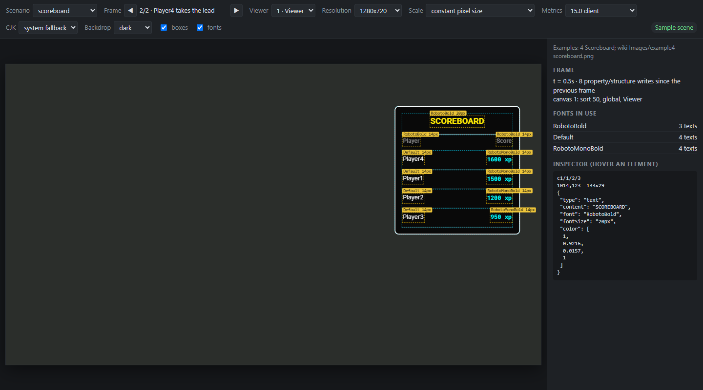
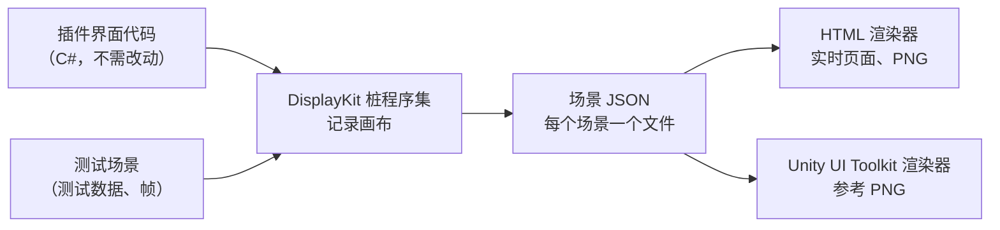
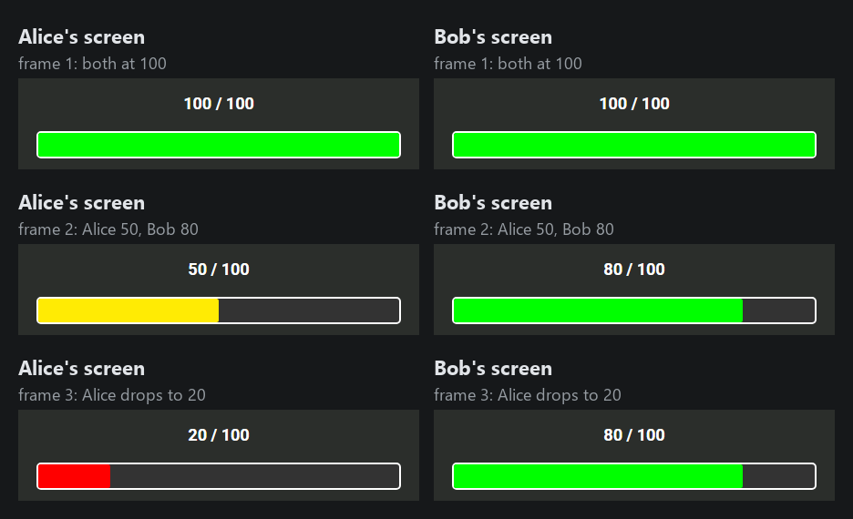
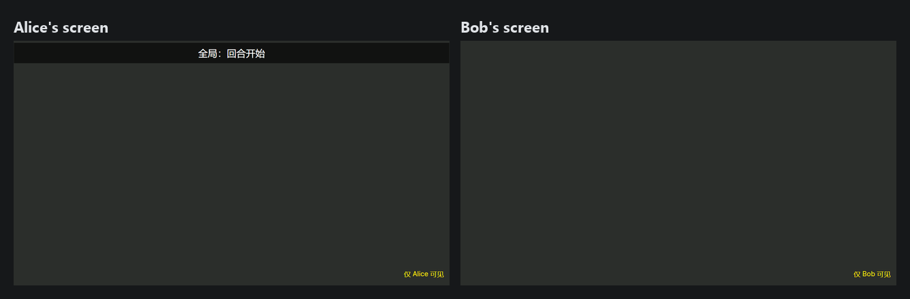
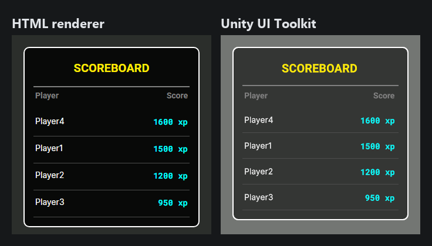

# DisplayKit preview

[English](README.md) | **简体中文**

在 SCP:SL 15.0 服务端发布之前，先看到你的 DisplayKit 界面。像平时一样用 C# 编写插件的界面代码，
再加几个测试场景（scenario），每次保存后浏览器里的预览就会自动重绘。



## 工作原理



- **桩程序集**（`src/DisplayKit.Stub`）的命名空间和类型与 DisplayKit 相同，但它不通过网络发送画布，
  而是把画布记录下来。
- **运行器**（`dkpreview.py run`）编译你的场景项目，逐个运行场景，每个场景输出一个 JSON 文件，
  其中包含各帧、各观看者和画布树。
- **两个渲染器**负责把这些 JSON 画出来：

| 渲染器 | 用途 |
| --- | --- |
| HTML（`html/`） | 日常开发。C# 一改，实时页面就重新加载；也能无头导出 PNG，供脚本和智能体使用。 |
| Unity UI Toolkit（`unity/`） | 校验还原度。把同一份 JSON 载入真正的 `UIDocument`，保存为 PNG 并附带元素矩形。 |

DisplayKit 本身尚未发布，这里的 API 依据 LabAPI Wiki 的 `DisplayKit*.md` 页面实现。Wiki 没写清楚或前后
矛盾的地方，桩程序集只能猜测；所有猜测都列在[参考文档](docs/reference.md#guesses)中（英文）。15.0
发布后请逐条核对。

## 快速上手：打开示例

只需要 Python 3.10 或更高版本。在仓库根目录运行：

```powershell
python -m pip install fonttools
python fonts.py                          # 下载两个渲染器共用的字体
python -m http.server 8765 --bind 127.0.0.1
```

打开 <http://127.0.0.1:8765/html/>。仓库自带三段录好的示例（位于 `examples/`）：

| 示例 | 展示内容 |
| --- | --- |
| `scoreboard` | Wiki 中的计分板示例：一个全局画布，分两帧更新 |
| `health-bar` | 每名玩家各自的画布：每个人只看到自己的血条 |
| `per-player-scope` | 全局横幅与每名玩家各自的标签同时显示，随后只对一名玩家隐藏横幅 |

按 Ctrl+C 停止服务器。

## 预览页面

| 控件 | 作用 |
| --- | --- |
| **Scenario** | 选择录好的场景。 |
| **Frame** | 逐帧查看场景录下的帧（点 ◀ ▶ 或按方向键）。 |
| **Viewer** | 以某名玩家的视角查看屏幕。玩家专属画布和可见性都会随观看者切换。 |
| **Resolution**、**Scale** | 屏幕尺寸；固定像素大小，或 Unity 的 *Scale With Screen Size*（1920x1080，match 0.5）。 |
| **Metrics** | `15.0 client`（默认）按真实客户端的文字位置绘制；`UI Toolkit reference` 与 Unity 渲染器一致。 |
| **CJK** | `system fallback` 用后备字体显示中文（最好情况）；`no fallback (□)` 显示缺字方框（最坏情况）。 |
| **Backdrop** | 画布后面的背景色。 |
| **boxes**、**fonts** | 给每个元素描边；给每段文字标出字体和字号。 |

侧边栏会列出正在使用的字体，并标出含有该字体所缺字符的文字。它还会显示本帧发送了多少次属性写入、
当前观看者能看到哪些画布，以及鼠标所指元素的详细信息。

只要画布是按玩家区分的，就要注意切换观看者。在 `health-bar` 示例中，每名玩家都有自己的画布：



## 实时预览你自己的 C# 代码

### 环境要求

| 用途 | 需要安装 |
| --- | --- |
| 编译场景 | .NET SDK 9 或更高版本（运行器面向 .NET 9 并允许前滚；桩程序集和场景面向 .NET Framework 4.8） |
| `ReferenceHub`、Mirror | SCP:SL 专用服务器（Steam） |
| UnityEngine UI Toolkit 模块 | Unity 6000.4.10f1（Unity 渲染器也需要它） |
| 导出 PNG | Chrome 或 Edge |
| `compare` | Pillow（`python -m pip install pillow`） |

`DisplayKitPreview.props` 默认使用 Unity Hub 和 Steam 的标准安装路径。如果你的路径不同，可以为
当前终端设置：

```powershell
$env:DisplayKitUnityManaged = 'D:/Unity/6000.4.10f1/Editor/Data/Managed/UnityEngine'
$env:ScpslManaged = 'D:/SCP Secret Laboratory Dedicated Server/SCPSL_Data/Managed'
```

### 监视模式

```powershell
python dkpreview.py watch scenarios/WikiExamples
```

打开它输出的网址。每次保存场景项目中的 `.cs` 文件，项目都会重新编译并运行（约 1.5 秒），页面随之
重绘。编译错误和场景异常会显示在画面上方，修好后自动消失。如果插件源码不在场景项目里，为每个
目录加一个 `--watch <dir>`。

## 为你的插件编写场景

把 DisplayKit 代码放进插件的一个类里，让它通过参数接收要显示的数值。插件在游戏事件中调用这个类，
场景则用测试数据调用同一个类。`scenarios/WikiExamples/ExamplesPage.cs` 就是按这种方式改写了
Wiki 示例。

**1. 在插件旁边新建一个场景项目。** 把环境变量 `DISPLAYKIT_PREVIEW_ROOT` 设为本仓库的路径：

```xml
<Project Sdk="Microsoft.NET.Sdk">
  <Import Project="$(DISPLAYKIT_PREVIEW_ROOT)\DisplayKitPreview.props" />
  <PropertyGroup><TargetFramework>net48</TargetFramework><LangVersion>latest</LangVersion></PropertyGroup>
  <ItemGroup>
    <ProjectReference Include="$(DisplayKitPreviewDir)src\DisplayKit.Stub\DisplayKit.Stub.csproj" />
    <ProjectReference Include="$(DisplayKitPreviewDir)src\DisplayKit.Preview\DisplayKit.Preview.csproj" />
    <Compile Include="..\src\Ui\**\*.cs" />  <!-- 插件的界面类，原样编译 -->
  </ItemGroup>
</Project>
```

**2. 编写场景。** 每个场景是一个静态方法：添加玩家、驱动插件界面、录制帧：

```csharp
[DisplayKitScenario("hud", Description = "SCP-049 cure HUD")]
public static void Hud(PreviewContext ctx)
{
    PreviewPlayer alice = ctx.AddPlayer("Alice");     // alice.Hub 是 DisplayKit 接受的 ReferenceHub
    CureHud hud = CureHud.Create(alice.Hub);          // 插件代码
    ctx.Frame("spawned");
    hud.SetProgress(0.4f);
    ctx.Frame(0.5f, "40%");                           // 推进模拟时间，录制一帧
}
```

**3. 运行 `python dkpreview.py watch <场景项目>`**，然后打开页面。

`PreviewContext` 的成员：

| 成员 | 作用 |
| --- | --- |
| `AddPlayer(name)` | 添加一名玩家。已全局生成的画布会按“中途加入”发送给这名玩家。 |
| `RemovePlayer(player)` | 移除一名玩家。 |
| `Frame(label)` | 立即录制一帧。 |
| `Frame(seconds, label)` | 先推进模拟时间，再录制一帧。 |
| `Time` | 当前模拟时间。 |

没有录制任何帧的场景会在结束时自动录一帧；最后一帧之后还有改动的，会再录一个 `end` 帧。没有添加
玩家的场景会自动得到一名叫 `Viewer` 的玩家。

切换 **Viewer** 可以检查每个人看到了什么。下图来自 `per-player-scope` 示例，全局横幅只对 Bob 隐藏了：



> [!IMPORTANT]
> 预览玩家的 `ReferenceHub` 只用来标识玩家。DisplayKit 的调用都接受它，但从它读取游戏状态会抛出异常，
> 用 `==` 比较它也会（UnityEngine.Object 的运算符会调用原生代码）。所以界面类应该通过参数接收要显示的数值。

### 让插件基于桩程序集编译

15.0 发布前，插件可以引用 `DisplayKit.Stub.csproj`，并导入 `DisplayKitPreview.props` 获取 Unity 6
引用，从而编译界面代码。15.0 发布后去掉对桩程序集的引用即可，游戏程序集提供相同的命名空间。

### 更完整的示例

| 项目 | 内容 |
| --- | --- |
| `scenarios/WikiExamples` | LabAPI Wiki 的示例和指南代码片段，外加一个字体覆盖测试页。自带的示例场景就来自这里。 |
| `scenarios/RoleIntro` | 一个完整的角色开场组件，每个阵营一个场景，另有一个生成评审图的脚本。见其 [README](scenarios/RoleIntro/README.md)（英文）。 |

## 命令参考

```powershell
python dkpreview.py run   scenarios/WikiExamples                    # 编译并运行全部场景 -> out/WikiExamples/*.json
python dkpreview.py watch scenarios/WikiExamples [--watch <dir>] [--port 8765]
python dkpreview.py png   scenarios/WikiExamples --scenario scoreboard --res 1280x720 --out out/png/sb.png
python dkpreview.py png   out/WikiExamples/health-bar.json --frame all          # 直接用场景文件，不编译
python dkpreview.py unity-build                                                 # 构建 Unity 渲染器
python dkpreview.py unity scenarios/WikiExamples --scenario scoreboard          # Unity PNG（附 .layout.json）
python dkpreview.py compare [--unity] [--wiki <LabAPI.wiki>/Images]             # 对比图，输出到 out/compare
```

`png` 和 `unity` 接受一个场景项目、一个场景文件夹或单个场景 `.json`，以及以下选项：

| 选项 | 取值 |
| --- | --- |
| `--scenario` | 只处理这个场景。 |
| `--frame` | 帧序号、`all` 或 `last`。 |
| `--viewer` | 观看者的连接 ID（玩家从 1 开始编号）。 |
| `--res` | `宽x高`，默认 `1920x1080`。 |
| `--scale` | `constant`（默认），或参考分辨率（如 `1920x1080`），对应 *Scale With Screen Size*。 |
| `--metrics` | `client`（默认）或 `reference`；见 [15.0 客户端文字度量](docs/reference.md#150-client-text-metrics)（英文）。 |
| `--cjk` | `fallback`（默认）或 `tofu`。 |
| `--badges` | 给每段文字标出字体。 |
| `--layout` | 另外输出每个元素的矩形到 `.layout.json`，两个渲染器的元素路径一致。 |
| `--no-build` | 直接使用上次运行生成的场景文件。 |
| `--out` | 输出 PNG 的路径。 |

## Unity 参考渲染器

HTML 渲染器是在模仿 UI Toolkit，而 Unity 渲染器用的就是 UI Toolkit 本身。它在一个最小的
Unity 6000.4.10f1 项目中，把同一份场景 JSON 载入真正的 `UIDocument` 并保存结果。用它来确认 HTML
渲染器没有误导你。

```powershell
python dkpreview.py unity-build      # 构建 unity/Build/DkRender.exe；需要已激活许可证的编辑器
python dkpreview.py unity examples/scoreboard.json --res 1280x720 --out out/scoreboard.unity.png
```



两者布局一致。HTML 中每行高出 2 px，是因为页面默认采用 15.0 客户端的文字度量，而 Unity 绘制的是原始
UI Toolkit（加上 `--metrics reference` 后两者相同）。半透明面板的颜色不同，是因为游戏在线性空间混合颜色，
而 CSS 在 sRGB 空间混合。

- 不构建播放器也能渲染：运行 `Unity.exe -batchmode -projectPath unity -executeMethod
  DisplayKitPreviewBuild.RenderInEditor -dkJobs <jobs.json>`，只是启动更慢。
- 编辑器装在非默认位置时，把 `DK_UNITY_EDITOR` 设为 `Unity.exe` 的路径。
- Unity 批处理模式要求运行它的 Windows 账户已在 Unity Hub 中登录，否则会报
  `com.unity.editor.headless was not found`，`unity-build` 会给出提示。
- 使用 `--cjk fallback` 时，渲染器会把微软雅黑加为后备字体。

## 字体

`fonts.py` 把 Roboto、Roboto Mono 和 Liberation Sans 下载到 `fonts/`。默认字体优先使用 Unity 自带的
Inter，找不到时再下载 Inter。两个渲染器使用同一批字体文件。DisplayKit 的 `FontType` 名称对应这些文件；
游戏实际附带的字体版本可能不同，度量也会略有差异。

## 参考文档

[docs/reference.md](docs/reference.md)（英文）包含以下细节：

- [Scene JSON](docs/reference.md#scene-json)：两个渲染器读取的场景格式。
- [HTML mapping](docs/reference.md#html-mapping)：HTML 渲染器如何复现 UI Toolkit 的布局，以及哪些方面没有模拟。
- [15.0 client text metrics](docs/reference.md#150-client-text-metrics)：文字位置修正及其测量方法。
- [Guesses](docs/reference.md#guesses)：桩程序集对未发布 API 的全部猜测。

## 许可证

[MIT](LICENSE)。`fonts.py` 下载的字体采用 SIL Open Font License，不属于本仓库。
